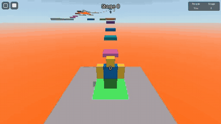
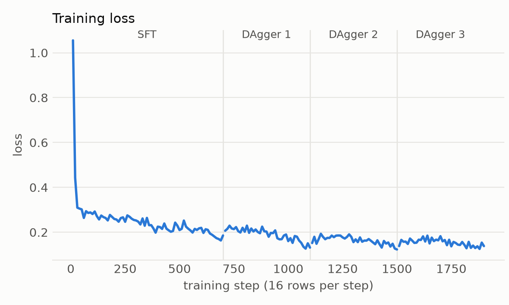
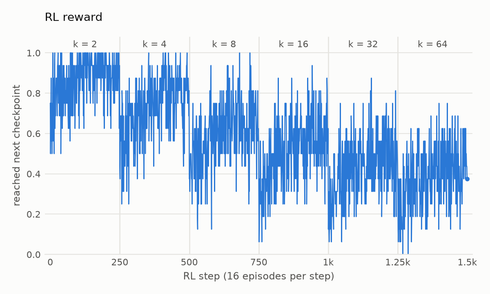

# Baconead
Baconhead is a 4B vision-language-action model that plays Roblox straight from the screen, with no access to game state. Every 300 ms it looks at the last two frames and a one-line task, then writes out the camera movement and the keys to hold for each of the next six 50 ms steps. It's trained in simulated Roblox games with scripted experts, first by behaviour cloning on expert play and then with rounds of DAgger, where the model plays and the expert relabels every state it reaches.

<p align="center">
  
</p>

<p align="center">
  
</p>

<p align="center">
  
</p>

Videos and every run's inputs: [`results/robloxagent/`](results/robloxagent). 

## Run and Train
Weights: [ibrahimansr/robloxagent](https://huggingface.co/ibrahimansr/robloxagent). 

```bash
pip install -r requirements.txt
```

Serve the model with vLLM on one H100, then let it play the frontmost Roblox window on your Mac:
```bash
modal deploy baconhead/live.py
python -m baconhead.live --url <server url> --seconds 60
```

Match the camera turn speed to your Roblox sensitivity:
```bash
python -m baconhead.live --calibrate
```

Play held-out obbies in the sim and replay the runs to mp4:
```bash
modal run baconhead/agent.py --games obby --ticks 600 --seeds 3
python -m baconhead.agent --video <run dir>
```

For training, here is our pipeline: behaviour cloning on scripted-expert play, then DAgger rounds, then async RL with
[miles](https://github.com/radixark/miles) (GRPO, reward = beat the next checkpoint, backplay starts from the
expert's runs, 1 H100 training + 1 H100 rolling out).

```bash
modal run baconhead/train/pipeline.py --games obby --base <base model> --rounds 3 --rl-rollouts 500
```
